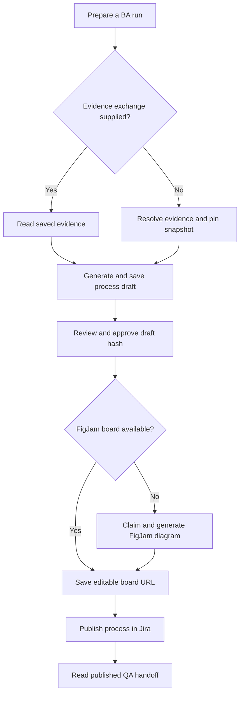

# ADR 0001 · Evidence-backed BA workflow

**Status** Accepted · 2026-11-22

## Context

The Business Analyst service turns evidence for one documented e-commerce operation into a business process and acceptance criteria. A reviewer needs to trace the process back to a specific API contract, validation rule, test scenario or Jira requirement. FigJam, Jira and QA need to use the same reviewed version. The first DEV acceptance case is Products Catalog `CreateMobilePhone`, exposed as `POST /mobile-phones`.

## Decision

Use a persisted BA run as the record of the operation, evidence, generated model, approval and publication. A run belongs to a `model-flow` session and has a UUID supplied by the caller. The session pins the LiveDocs snapshot. The run pins the inputs and exports for the version that the reviewer approves.

| Component | Responsibility |
| --- | --- |
| Knowledge Assistant | Supply the operation contract, documented validation rules, observed Allure scenarios and source references from the selected LiveDocs snapshot. |
| BA API and MongoDB | Resolve or reuse evidence, validate the process model, produce exports, and persist the draft and publication state. |
| Azure Foundry | Generate the structured process and Given/When/Then acceptance criteria from the supplied evidence and optional Jira requirements. |
| Figma MCP client | Create an editable FigJam diagram from the saved Mermaid and return the board URL. |
| Jira Cloud | Provide requirements for a linked issue and hold the reviewed process, criteria, source links and FigJam link. |
| QA | Read the published run and its provenance through the handoff endpoint. |

## Workflow

### Prepare and review

1. The client creates a session and prepares a run with a service, HTTP method and path. It can supply an existing `evidenceExchangeId`. Otherwise BA derives an exchange UUID from the run ID. For a new capture, it checks the Knowledge catalog, resolves the operation and stores its evidence. An unpinned session selects the sole live snapshot for the requested service. BA checks that the contract and source records match the operation and pinned snapshot.
2. If the session includes `jiraIssueKey`, BA reads that issue's summary, description and update timestamp in the configured Jira project. The saved Jira input has its own source ID. The Foundry prompt treats Jira requirements as intent and uses Knowledge evidence for documented or observed behavior.
3. BA calls the configured version of the Foundry Prompt Agent. The setup script defaults to `ecommerce-business-analyst` on the `gpt-6-luna` deployment. The response follows the `ProcessDraft` JSON schema. BA validates the graph, including actor assignments, start and end steps, reachability and decision branches. Steps, transitions and criteria cite source IDs present in the captured input. The draft preserves open questions, missing evidence and upstream limitations.
4. BA saves the draft with the evidence exchange ID, source commits and bundle hashes, agent version and response ID. The same model produces BPMN with actor lanes and diagram coordinates and Mermaid for FigJam. Reviewers can download the run as `flow.json` and the diagrams as `process.bpmn` and `process.mmd`. The SHA-256 digest covers the saved draft, including its provenance and exports. [Run implementation](../../src/ecommerce_store_ba/application/run_service.py)

### Publish and hand off

The run endpoints are under `/api/v1/sessions/{sessionId}/runs/{runId}` and use the BA `X-Api-Key`.

| Action | Effect |
| --- | --- |
| `GET` the run | Review the saved draft and its `draftSha256`. |
| `POST /figjam` | Submit the approved hash and claim diagram generation. On `claimed: true`, the connected Figma client uses the returned `generate_diagram` arguments. |
| `PUT /publication` | Submit the approved hash and an editable `figjamUrl`. BA saves the URL before calling Jira. An existing board for the same draft can be supplied directly. |
| `GET /handoff` | Return the published run for QA with its approved draft, evidence exchange, pinned snapshot, Jira issue and FigJam link. |

FigJam creation runs in a supported Figma MCP client such as Codex. That client supplies its Figma authorization and returns the board link to BA. The service owns the approved Mermaid and publication state. [Figma MCP setup](https://developers.figma.com/docs/figma-mcp-server/remote-server-installation/)

For a session linked to Jira, BA adds one section per run to the existing issue description and preserves the rest of the description. With an unlinked session, BA creates an issue of the configured type with a unique run label. Both carry the reviewed process, acceptance criteria, citations and FigJam link. BA records the Jira issue and publication timestamp before serving the QA handoff. [Jira adapter](../../src/ecommerce_store_ba/infrastructure/jira_client.py)

## Retry and recovery

Keep the same session UUID and run UUID for retries. Once a draft has been saved, the prepare request returns it again. Use a new run UUID for a revised draft. A time-bounded MongoDB lease serializes active operations on each run. A separate issue lease serializes BA writes from different runs to the same Jira issue.

| Situation | Recovery |
| --- | --- |
| `figjam_pending` | Retrieve the board URL from the original Figma result or find the board by the BA run suffix. Submit that URL with the same draft hash. |
| `ready_for_jira` | Keep the recorded board URL and retry publication for the same run. |
| Jira issue creation result is uncertain | Retry publication to look up the unique run label. If the issue is still absent from search, the run remains `jira_pending`. |
| Jira explicitly rejects issue creation | Correct the Jira configuration and retry the same publication. BA clears the rejected create checkpoint. |
| Publication completed | Repeating the same publication returns the saved result. The handoff endpoint exposes it to QA. |

## Deployment and consequences

- DEV enables BA through the digest-pinned `app_images.ba` entry in Terraform. The Container App uses its system-assigned identity with the `Azure AI User` role to call Foundry. The BA API key, MongoDB URI, Knowledge API key and Jira token are Container App secrets. [DEV deployment](https://github.com/MichalBoczula/ECommerceStore.Terraform/blob/main/docs/ba-deployment.md)
- A saved run can be reviewed or retrieved after a restart. The exact draft hash ties each published result to its citations, agent version and artifacts.
- Publication crosses independent provider calls. MongoDB checkpoints support recovery by reusing a confirmed board or reconciling the Jira label after an interrupted create. Jira search visibility can delay confirmation.
- BA/06 verifies the deployed `CreateMobilePhone` workflow from live Knowledge evidence through Foundry, FigJam, Jira and QA. [Run guide](../workflow.md)
